# AI Tuition Assistant

SE 4458 Midterm 1 — Group 1. A conversational assistant that answers student questions about tuition
deadlines, installments, payment rules, balances and payments. It combines:

1. **AI Agent** (Python CLI) using real LLM function calling
2. **MCP Server** exposing `search_tuition_policies` over an indexed policy document
3. **Tuition REST API** (FastAPI) backed by **PostgreSQL**
4. **API Gateway** through which all REST traffic is routed

## Quick start (reproduce the results)

Prerequisites: Docker Desktop, Python 3.12, a free Gemini API key (https://aistudio.google.com/apikey).

The commands below are for **bash** (Git Bash on Windows). On macOS/Linux use `python3.12 -m venv .venv`
and `.venv/bin/python` instead of `py -3.12 -m venv .venv` and `.venv/Scripts/python`.
The values in `.env.example` work as they are for a local run; only `GEMINI_API_KEY` must be added
for the chat (tests, smoke test and MCP demo do not need it). These steps were verified on a fresh
clone of this repository.

```bash
# 1. Configuration
cp .env.example .env        # then add GEMINI_API_KEY (change the passwords for anything non-local)

# 2. Start PostgreSQL, Tuition API, MCP server and Kong gateway (demo data is seeded automatically)
docker compose up -d --build

# 3. Python environment for tests, smoke tests and the agent
py -3.12 -m venv .venv
.venv/Scripts/python -m pip install -r api/requirements-dev.txt -r mcp_server/requirements-dev.txt -r agent/requirements-dev.txt

# 4. Automated tests (no LLM, no cloud needed)
cd api && ../.venv/Scripts/python -m pytest -q && cd ..
cd mcp_server && ../.venv/Scripts/python -m pytest -q && cd ..
cd agent && ../.venv/Scripts/python -m pytest -q && cd ..

# 5. Gateway checks and the three MCP retrieval tests
.venv/Scripts/python gateway/smoke_test.py
cd mcp_server && ../.venv/Scripts/python retrieval_demo.py && cd ..

# 6. Chat with the assistant in the browser: http://localhost:8090 (student1 / SEED_DEMO_PASSWORD)
cd agent && ../.venv/Scripts/python -m tuition_agent.web
#    or in the terminal:
cd agent && ../.venv/Scripts/python -m tuition_agent -u student1
```

Swagger UI: http://localhost:8000/docs · Demo users and data: [Seed test data](#seed-test-data) ·
Reset demo data: `docker compose exec api python -m app.seed --reset && docker compose restart gateway`.

## Repository layout

| Path | Contents |
|---|---|
| `api/` | FastAPI tuition service, tests, Dockerfile |
| `mcp_server/` | MCP server and policy indexer, retrieval demo, tests, Dockerfile |
| `agent/` | AI agent CLI (LLM loop, tools, MCP client, REST client, trace logger), tests |
| `gateway/` | Kong declarative config, start script, Dockerfile, smoke test |
| `deploy/azure/` | Azure deployment script |
| `docs/` | Policy document, ER diagram, OpenAPI spec, assumptions, tool traces, test results |
| `docker-compose.yml` | Local stack (PostgreSQL, API, MCP server, gateway) |

## Architecture

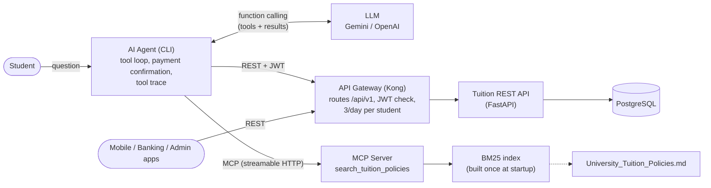

- The **LLM only selects tools and writes the answer**; the agent executes every call.
- **REST traffic always goes through the gateway**; the MCP path is separate, as required.
- The student number used for REST calls always comes from the logged-in user's JWT, never from the
  prompt or the LLM.

## Data model (ER diagram)

See [docs/er-diagram.md](docs/er-diagram.md).

### Seed test data

`python -m app.seed` loads the following demo data. All demo users share the password from
`SEED_DEMO_PASSWORD` in `.env`.

| Student No | User | Term | Amount | Paid | Balance | Scenario |
|---|---|---|---|---|---|---|
| 20230001 | `student1` | 2026-FALL | 3000.00 | 0.00 | 3000.00 | Installment eligible |
| 20230001 | `student1` | 2027-SPRING | 3000.00 | 0.00 | 3000.00 | |
| 20230002 | `student2` | 2026-FALL | 2250.00 | 2250.00 | 0.00 | Scholarship, fully paid |
| 20230002 | `student2` | 2027-SPRING | 2250.00 | 1000.00 | 1250.00 | Partially paid |
| 20230003 | `student3` | 2026-FALL | 250.00 | 0.00 | 250.00 | Below $300 installment threshold |
| 20230004 | `student4` | 2026-FALL | 3000.00 | 1500.00 | 1500.00 | Half paid |
| 20230005 | — | — | — | — | — | No tuition record |

Non-student users: `bank1` (role `bank`), `admin1` (role `admin`).

## REST API

- Swagger UI: `http://localhost:8000/docs` (local gateway) · cloud (removed after grading): http://13.48.42.90:8000/docs
- OpenAPI specification: [docs/openapi.json](docs/openapi.json) (regenerate with
  `cd api && ../.venv/Scripts/python -m app.export_openapi`; a test fails if it is out of date)

| Operation | Method & route | Auth | Paging |
|---|---|---|---|
| Login | `POST /api/v1/auth/login` | — | — |
| Current identity | `GET /api/v1/auth/me` | Any role | — |
| Query Tuition (Mobile) | `GET /api/v1/mobile/tuition/{studentNo}` | No (3 calls / student / day) | No |
| Query Tuition (Banking) | `GET /api/v1/banking/tuition/{studentNo}` | `bank`, `student` (own) | No |
| Pay Tuition (Banking) | `POST /api/v1/banking/payments` | `bank`, `student` (own) | No |
| Add Tuition (Admin) | `POST /api/v1/admin/tuitions` | `admin` | No |
| Add Tuition Batch (Admin) | `POST /api/v1/admin/tuitions/batch` (CSV upload) | `admin` | No |
| Unpaid Tuition Status (Admin) | `GET /api/v1/admin/tuitions/unpaid?term=&page=&pageSize=` | `admin` | Yes |

Errors always use `{"error": {"code": "...", "message": "...", "details": ...}}`. The error code
catalog is in the Swagger UI description.

## API Gateway

**Kong 3.9 (open source, DB-less)**, configured declaratively in [gateway/kong.yml](gateway/kong.yml).
All REST traffic goes through it, including the AI agent (`GATEWAY_BASE_URL`). The MCP server is a
separate path and does not go through the gateway, as the assignment's architecture requires.

- Local gateway URL: `http://localhost:8000` → upstream Tuition API on port `8080`
- Cloud gateway URL (AWS, removed after grading): `http://13.48.42.90:8000` → see [Cloud deployment](#cloud-deployment)

| Public route (gateway) | Methods | Upstream | Gateway policy |
|---|---|---|---|
| `/api/v1/health` | GET | Tuition API | — |
| `/api/v1/auth/login` | POST | Tuition API | — |
| `/api/v1/mobile/tuition/{studentNo}` | GET | Tuition API | **Rate limit: 3 / day per student number** |
| `/api/v1/auth/me` | GET | Tuition API | **JWT required** |
| `/api/v1/banking/...` | GET, POST | Tuition API | **JWT required** |
| `/api/v1/admin/...` | GET, POST | Tuition API | **JWT required** |
| `/docs`, `/openapi.json` | GET | Tuition API | — |

How it works:

- **JWT:** the gateway verifies the token signature (HS256, shared `JWT_SECRET`), issuer and expiry
  before forwarding. Roles and student ownership are then checked by the API.
- **Rate limit keyed by student number, not IP:** a `pre-function` copies the student number from the
  path into the `X-Student-No` header (overwriting any client value), and the `rate-limiting` plugin
  limits by that header. The API keeps its own database counter as well.
- **Secrets:** `kong.yml` contains placeholders only; [gateway/start-kong.sh](gateway/start-kong.sh)
  fills in `JWT_SECRET` and the upstream URL when the container starts.

Sample error responses from the gateway:

```text
GET /api/v1/banking/tuition/20230001        (no token)
401 {"message":"Unauthorized"}

GET /api/v1/mobile/tuition/20230003         (4th call of the day)
429 {"message":"Daily query limit of 3 reached for this student number", "request_id":"..."}
```

Verify with `python gateway/smoke_test.py` (12 checks: public route, protected route with/without a
valid token, other student's data, rate limit, unknown route). Latest result:
[docs/traces/gateway_smoke_test.txt](docs/traces/gateway_smoke_test.txt).

## MCP Server

### Indexing approach

- The policy document is split by Markdown headings: one chunk per `##`/`###` section that has body
  text (26 chunks). Text before the first `##` becomes section `intro`; headings inside code blocks
  are ignored. Each chunk keeps its section ID (e.g. `3.2`), heading and parent heading.
- Chunks are indexed with BM25 (`rank-bm25`, full-text). Tokens are lowercased, stopwords are removed
  and a trailing plural `s` is stripped (`installments` → `installment`). Headings are indexed together
  with the body so section titles also match.
- The index is built **once at server startup** and kept in memory; queries never re-read the file.
- Embeddings were not used: the document is small and BM25 ranks the expected sections first for the
  demo queries (see `mcp_server/tests/test_index.py`).

### Server and tool schema

A real MCP server built with the official Python SDK (`mcp` 1.x, `FastMCP`), served over the
**streamable HTTP** transport at `http://localhost:8001/mcp` (health check: `GET /health`).

| Tool | `search_tuition_policies` |
|---|---|
| Input | `query: string` (required, non-empty), `top_k: integer` (1-10, default 3) |
| Output | `{"document": "University_Tuition_Policies.md", "matches": [{"section", "heading", "text", "score"}]}` |

Example output (shortened):

```json
{
  "document": "University_Tuition_Policies.md",
  "matches": [
    {"section": "4.1", "heading": "Late fee rule", "text": "A **2% one-time late fee** may be assessed ...", "score": 9.6821}
  ]
}
```

### Running the server and the three retrieval tests

```bash
cd mcp_server
../.venv/Scripts/python -m pip install -r requirements-dev.txt
../.venv/Scripts/python server.py            # terminal 1
../.venv/Scripts/python retrieval_demo.py    # terminal 2: runs 3 queries via an MCP client
```

`retrieval_demo.py` connects with a real MCP client over HTTP and saves the results to
[docs/traces/mcp_retrieval_demo.json](docs/traces/mcp_retrieval_demo.json):

| Query | Top sections |
|---|---|
| When is the payment deadline? | 2.2 Spring term, 2.1 Fall term, 2.3 Payment posting |
| Can I pay my balance in installments? | 8.2 FAQ on installments, 8.4, 3.2 Number and size of installments |
| What happens if I pay late? Is there a late fee? | 4.1 Late fee rule, 4.2 Example, 4.3 Exceptions |

## AI Agent

Flow per question: user question → LLM (function calling, `tool_choice=auto`) selects tools → the
agent executes them (MCP for policy, REST via the gateway for live data) → results go back to the LLM
→ grounded answer with policy section references. The LLM never calls a backend directly.

| Tool | Backend | Notes |
|---|---|---|
| `search_tuition_policies(query, top_k)` | MCP server | Policy passages with section IDs |
| `get_my_tuition()` | `GET /api/v1/banking/tuition/{studentNo}` via gateway | Student number comes from the JWT |
| `pay_tuition(term, amount)` | `POST /api/v1/banking/payments` via gateway | Requires typing `yes`; agent generates the `transactionId` |

Two interfaces run the same agent:

- **Web chat** (`python -m tuition_agent.web` → http://localhost:8090): student login, chat with
  example questions, an expandable tool trace under every answer (MCP vs REST badges), and a payment
  confirmation card with **Confirm payment** / **Cancel** buttons. The page talks only to this local
  server (bound to `127.0.0.1`), which runs the agent.
- **CLI** (`python -m tuition_agent`): the same flow in the terminal; payments are confirmed by
  typing `yes`.

- **Login:** the user logs in as a student at start-up; non-student accounts are rejected.
- **Payment confirmation (enforced in code):** before calling the payment API the agent fetches the
  live balance and shows student, term, amount, current balance and balance after. The payment API is
  called only after the user clicks **Confirm payment** (web) or types exactly `yes` (CLI). Invalid
  amounts or amounts above the term balance are rejected before the user is asked.
- **Tool trace:** every question prints the tool names, inputs and results, and saves a JSON file
  (`docs/traces/agent_<timestamp>_<question>.json`) with the final answer and LLM token usage.

### Demo traces (real LLM)

Recorded with `gemini-3.5-flash-lite` against the docker compose stack (REST through the Kong
gateway, see the [gateway access log](docs/traces/gateway_access_log_agent_demo.txt)), user
`student1`, fresh seed data:

| Scenario | Question | Tools selected by the LLM | Trace |
|---|---|---|---|
| 1. MCP only | When is the payment deadline? | `search_tuition_policies` | [trace](docs/traces/agent_20261121-222037_when-is-the-payment-deadline.json) |
| 2. API only | What is my balance? | `get_my_tuition` | [trace](docs/traces/agent_20261121-222039_what-is-my-balance.json) |
| 3. Combined | Can I pay my outstanding balance in installments? | `get_my_tuition` + `search_tuition_policies` | [trace](docs/traces/agent_20261121-222041_can-i-pay-my-outstanding-balance-in-inst.json) |
| 4. Payment | Pay part of my balance → Pay 500 for 2026-FALL | none (asks for term/amount) → `pay_tuition` after `yes` | [trace 1](docs/traces/agent_20261121-222041_pay-part-of-my-balance.json), [trace 2](docs/traces/agent_20261121-222043_pay-500-for-2026-fall.json) |
| Isolation | Show me the balance of student 20230002 | none (refuses) | [trace](docs/traces/agent_20261121-222044_show-me-the-balance-of-student-20230002.json) |

LLM answers are not fully deterministic; a re-run can word answers differently or pick a different
search query, but the tool choice per scenario is checked by the mock-LLM tests.

Run the CLI (requires the API, MCP server and an LLM key in `.env`):

```bash
cd agent
../.venv/Scripts/python -m pip install -r requirements-dev.txt
../.venv/Scripts/python -m tuition_agent                 # interactive
../.venv/Scripts/python -m tuition_agent -u student1 -q "What is my balance?"
```

## Local setup

Prerequisites: Docker Desktop (full stack) and Python 3.12 (tests and the agent CLI).

### Full stack with one command

```bash
cp .env.example .env          # then set POSTGRES_PASSWORD, JWT_SECRET, SEED_DEMO_PASSWORD, GEMINI_API_KEY
docker compose up -d --build
```

| Service | Container | Host port | Notes |
|---|---|---|---|
| PostgreSQL | `tuition-db` | 5432 | Demo data is seeded automatically when the API starts (idempotent) |
| PostgreSQL (tests) | `tuition-db-test` | 5433 | Disposable database for `pytest` |
| Tuition API | `tuition-api` | — | Not published; reachable only through the gateway |
| MCP server | `tuition-mcp` | 8001 | `http://localhost:8001/mcp`, health: `/health` |
| API Gateway (Kong) | `tuition-gateway` | 8000 | `http://localhost:8000` — Swagger UI at `/docs` |

Check: `http://localhost:8000/api/v1/health` and `http://localhost:8001/health`.
Reset the demo data (also restart the gateway to clear its rate-limit counters):

```bash
docker compose exec api python -m app.seed --reset
docker compose restart gateway
```

### Agent CLI and tests (run on the host)

```bash
py -3.12 -m venv .venv
.venv/Scripts/python -m pip install -r api/requirements-dev.txt -r mcp_server/requirements-dev.txt -r agent/requirements-dev.txt
cd agent && ../.venv/Scripts/python -m tuition_agent -u student1
```

### Running the API without Docker (development)

```bash
docker compose up -d db db-test mcp
cd api
../.venv/Scripts/python -m app.seed --reset
../.venv/Scripts/python -m uvicorn app.main:app --host 0.0.0.0 --port 8080
```

If the API runs on the host, the gateway must reach it at `host.docker.internal`:
set `API_UPSTREAM=http://host.docker.internal:8080` in `.env` and run `docker compose up -d --no-deps gateway`.

## Testing

All tests run automatically with `pytest`, without a live LLM and without the cloud deployment.
API tests use the separate PostgreSQL container `db-test` (`docker compose up -d db-test`); each test
runs in a transaction that is rolled back.

| Suite | Command | Tests | What is covered |
|---|---|---|---|
| Tuition API | `cd api && ../.venv/Scripts/python -m pytest -q` | 133 | Every operation with success and error/edge cases: login and JWT validation, role and ownership checks, mobile query + daily limit (incl. day change in Istanbul time), banking query, payments (partial/full, duplicate transaction ID, amount above balance, invalid amounts, concurrent payments), admin add/update, concurrent creates of the same student (real parallel transactions), CSV batch (row errors, BOM, CRLF/quoted cells, trailing commas, malformed/NUL/oversized files rejected before any write, row and size limits, concurrent batches without deadlock), unpaid paging, error format, OpenAPI file up to date |
| MCP server | `cd mcp_server && ../.venv/Scripts/python -m pytest -q` | 29 | Chunker, BM25 ranking for the demo queries, top-k and empty-query validation, index built once, MCP protocol tests with a real client session |
| AI agent | `cd agent && ../.venv/Scripts/python -m pytest -q` | 68 | Mock LLM: tool dispatch for the 4 demo scenarios, payment only after `yes` or the Confirm button, web chat API, isolation from other students, REST/MCP client error handling, trace content, Gemini thought-signature round trip |

Latest run: **230 tests passed** — full log in [docs/test-results.txt](docs/test-results.txt).
The API suite takes about 2 minutes because every login runs the real password hash (PBKDF2).

Additional checks against the running stack: `gateway/smoke_test.py` (12 gateway checks) and
`mcp_server/retrieval_demo.py` (3 MCP retrieval queries over HTTP).

## Cloud deployment

The system is deployed on **Amazon Web Services (AWS)**: one EC2 instance in `eu-north-1`
(Stockholm) runs the same docker compose stack as the local setup (PostgreSQL, Tuition API, MCP
server, Kong gateway). It was created with one script, [deploy/aws/deploy.sh](deploy/aws/deploy.sh),
run in AWS CloudShell.

> **Note:** After the midterm was graded (November 2026) the AWS instance was removed to stop cloud
> costs, so the URLs below no longer respond. The cloud run is documented by the saved results in
> [docs/traces/cloud](docs/traces/cloud) and the AWS screenshots below. The same deployment can be
> recreated with [deploy/aws/deploy.sh](deploy/aws/deploy.sh) (see
> [Deploy it yourself](#deploy-it-yourself-aws)); it gets a new public IP.

| Endpoint | URL |
|---|---|
| **API Gateway (Kong)** | **http://13.48.42.90:8000** |
| Swagger UI (through the gateway) | http://13.48.42.90:8000/docs |
| Health check (through the gateway) | http://13.48.42.90:8000/api/v1/health |
| MCP server | http://13.48.42.90:8001/mcp (health: `/health`) |

```text
Internet ──► :8000 Kong gateway ──► Tuition API ──► PostgreSQL      (EC2 instance, docker compose)
Agent    ──► :8001 MCP server
```

- **Network:** the security group opens only ports 8000 (gateway) and 8001 (MCP). PostgreSQL and the
  Tuition API are not reachable from the internet, so all REST traffic goes through Kong.
- **Secrets:** `JWT_SECRET` and the database password are generated on the instance at first boot and
  never leave it; the demo password is generated by the deploy script. The cloud demo password is
  therefore different from the local one and is available from the author on request.
- **Cost:** AWS Free plan credits (`c7i-flex.large`, 2 vCPU / 4 GB, 20 GB disk).

Verification against the cloud deployment (agent running locally, all REST calls to the AWS gateway,
policy search to the AWS MCP server, real LLM):

| Check | Evidence |
|---|---|
| Gateway: public/protected routes, 401, 403, 429 rate limit, 404 | [docs/traces/cloud/gateway_smoke_test_aws.txt](docs/traces/cloud/gateway_smoke_test_aws.txt) |
| Three MCP retrieval queries | [docs/traces/cloud/mcp_retrieval_demo_aws.json](docs/traces/cloud/mcp_retrieval_demo_aws.json) |
| Agent: MCP-only, API-only, combined, confirmed payment | [docs/traces/cloud/](docs/traces/cloud/) (`agent_*.json`) |

Point the agent (CLI or web chat) at the cloud by setting in `.env`:

```bash
GATEWAY_BASE_URL=http://13.48.42.90:8000
MCP_SERVER_URL=http://13.48.42.90:8001/mcp
```

### Deploy it yourself (AWS)

1. Create an AWS account (Free plan) and open **CloudShell** in the console.
2. Run:

   ```bash
   git clone https://github.com/mozankaya/se4458-ai-tuition-assistant.git
   cd se4458-ai-tuition-assistant && bash deploy/aws/deploy.sh      # about 10 minutes
   ```

3. The script prints the gateway URL, MCP URL, demo password and the clean-up commands
   (`aws ec2 terminate-instances ...`, `aws ec2 delete-security-group ...`).

New Free plan accounts can be limited to some regions; the script uses `eu-north-1` by default
(override with `AWS_REGION=...`). The startup script ([deploy/gcp/vm-startup.sh](deploy/gcp/vm-startup.sh))
installs Docker, clones this repository, writes `.env` with random secrets and runs
`docker compose up -d --build db api mcp gateway`.

### Alternative deployment scripts (prepared, not used)

| Script | Target | Why it was not used |
|---|---|---|
| [deploy/azure/deploy.ps1](deploy/azure/deploy.ps1) | Azure Container Apps + PostgreSQL Flexible Server + Container Registry | Azure for Students and a personal Azure account both stayed in Microsoft's manual account review during the project week |
| [deploy/gcp/deploy.sh](deploy/gcp/deploy.sh) | Google Cloud Compute Engine VM (same docker compose stack) | The Google Cloud free trial required a 1,500 TRY prepayment for accounts from Turkey |

These two scripts were syntax-checked and dry-run but never executed against a real subscription.

## LLM cost

- Default model: `gemini-3.5-flash-lite` on the **Gemini API free tier** — the demo costs **$0**.
  Switching to OpenAI (`LLM_PROVIDER=openai`, default `gpt-4o-mini`) only needs `.env` changes.
- Measured usage for the six demo questions (from the saved traces): **10 LLM calls, 15,489 prompt
  tokens and 568 completion tokens** in total, i.e. about 1,550 prompt + 60 completion tokens per
  LLM call. Most prompt tokens are the system prompt, tool schemas and tool results.
- Estimated paid cost = `prompt_tokens × input price + completion_tokens × output price` from the
  provider's current price list; every trace file records the exact `token_usage` for this.
- **Low-cost / testable approach:** all automated tests use a scripted mock LLM (no API key, no
  network, no cost). The live LLM is only needed for the interactive demo.

## Assumptions

Summary of the main decisions; the full list is in [docs/ASSUMPTIONS.md](docs/ASSUMPTIONS.md).

- **Money and rounding:** amounts are `NUMERIC(12,2)` / `Decimal`, never floats; inputs with more than
  2 decimals are rejected; JSON shows numbers with 2 decimals.
- **Balance scope:** Query Tuition returns the overall total and balance **plus a per-term breakdown**.
  Pay Tuition is per term; the amount must be `> 0` and `≤` that term's balance (no overpayment).
- **Duplicates:** a reused `transactionId` is rejected with `409`, even with an identical payload. Add
  Tuition is create-or-update by `(studentNo, term)`; the amount may not drop below the paid amount; a
  batch CSV applies rows independently (last duplicate row wins) and reports per-row errors. Concurrent
  creates for the same student are serialized by a row lock (one `CREATED`, one `UPDATED`), and a
  malformed CSV is rejected as a whole before any row is saved.
- **Mobile limit:** 3 calls per student number per day (Istanbul calendar day in the API, UTC day in
  Kong; both apply). Calls for unknown student numbers count too.
- **Identity:** JWT (HS256) for demo users with roles `student`, `bank`, `admin`. Students can only
  access their own student number (`403` otherwise); the agent takes the student number from the JWT.
- **Policy interpretation:** the assistant cites sections, never promises installment approval
  (§3.4), and needs both the balance and the policy for personal eligibility questions (§3.1: $300).
- **API errors:** API errors use `{"error": {"code", "message", "details"}}`; errors created by the
  gateway itself (401, 404, 429) use Kong's `{"message": ...}` format.
- **Deployment:** AWS EC2 with docker compose (Azure stayed in account review; Google Cloud required a prepayment). Kong instead of Azure API Management, because APIM's Consumption tier lacks
  `rate-limit-by-key` (Kong works the same locally and in the cloud).

## Demo

### Evidence in this repository

| Requirement | Evidence |
|---|---|
| Three agent scenarios (MCP-only, API-only, combined) | [Demo traces](#demo-traces-real-llm) |
| Confirmed simulated payment | [payment trace](docs/traces/agent_20261121-222043_pay-500-for-2026-fall.json) |
| Three distinct MCP retrieval tests | [docs/traces/mcp_retrieval_demo.json](docs/traces/mcp_retrieval_demo.json) |
| Protected gateway route, error responses, rate limit | [docs/traces/gateway_smoke_test.txt](docs/traces/gateway_smoke_test.txt) |
| Agent REST calls go through the gateway | [docs/traces/gateway_access_log_agent_demo.txt](docs/traces/gateway_access_log_agent_demo.txt) |
| Unit tests run | [docs/test-results.txt](docs/test-results.txt) |
| Cloud deployment (AWS) works end to end | [docs/traces/cloud/](docs/traces/cloud/) and [Cloud deployment](#cloud-deployment) |

### Screenshots

All screenshots are in [docs/screenshots/](docs/screenshots/). The web chat screenshots (6-10) belong
to the traces `docs/traces/agent_20261122-1847*` … `-185043*`.

**Local stack and tests**

| | |
|---|---|
| 1. `docker compose ps`: all services healthy<br>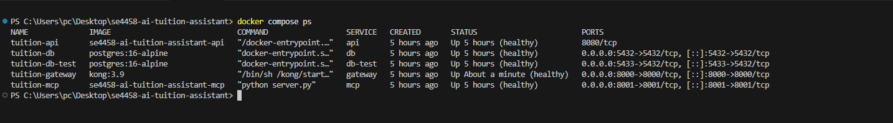 | 2. Swagger UI through the gateway (locks = protected routes)<br>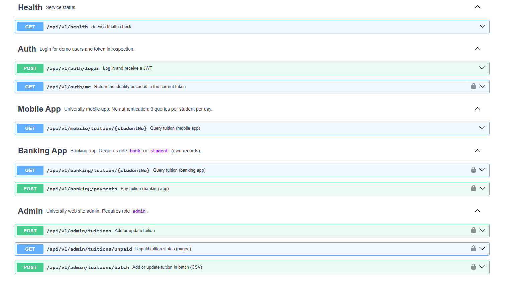 |
| 3a. Tuition API tests (screenshot of 22 Nov: 121 passed; 133 since the concurrency and CSV edge-case tests)<br>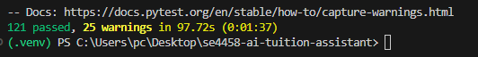 | 3b. MCP server tests (29 passed)<br>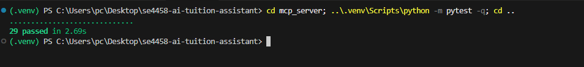 |
| 3c. Agent tests (68 passed)<br>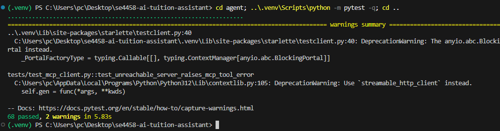 | 5. Three MCP retrieval queries over HTTP<br>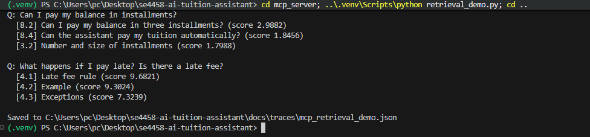 |

4. Gateway smoke test: protected route (401 without / with forged token), 403 for another student,
429 rate limit keyed by student number, 404 unknown route

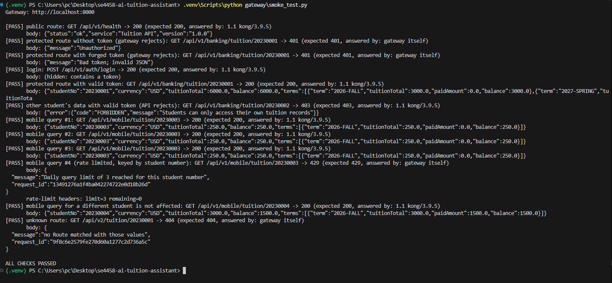

**AI agent (web chat)**

| | |
|---|---|
| 6. MCP-only: payment deadline<br>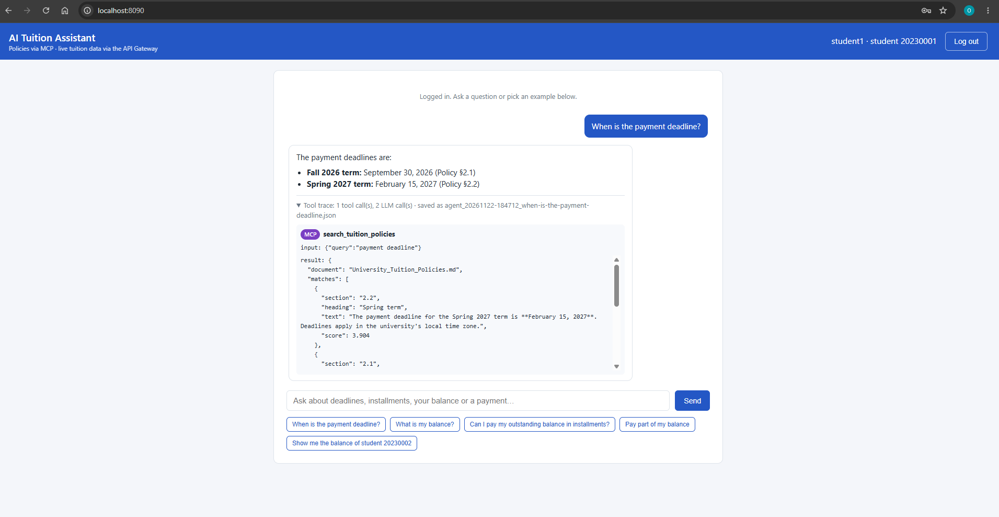 | 7. API-only: balance through the gateway<br>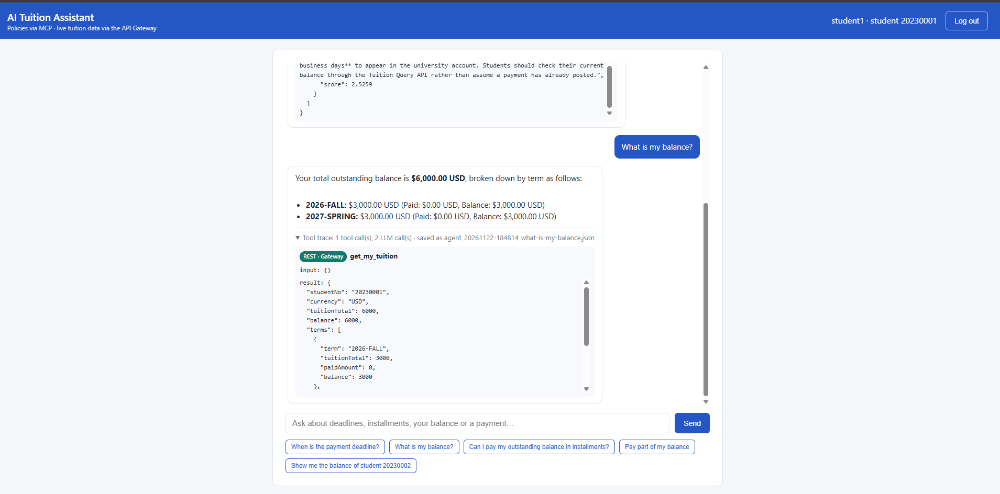 |
| 8. Combined: installments (balance + policy)<br>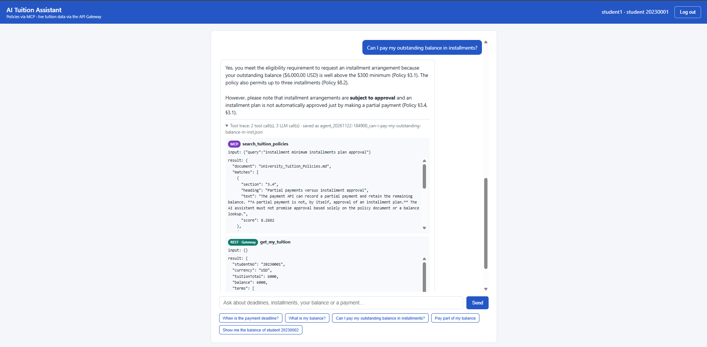 | 9. Payment confirmation card (nothing paid yet)<br>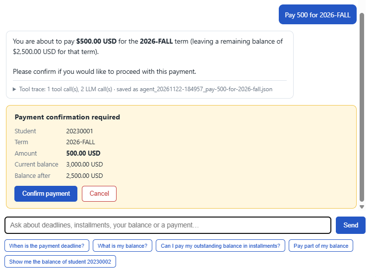 |

10. Confirmed simulated payment (`pay_tuition`, `confirmation: yes`, status `SUCCESS`)

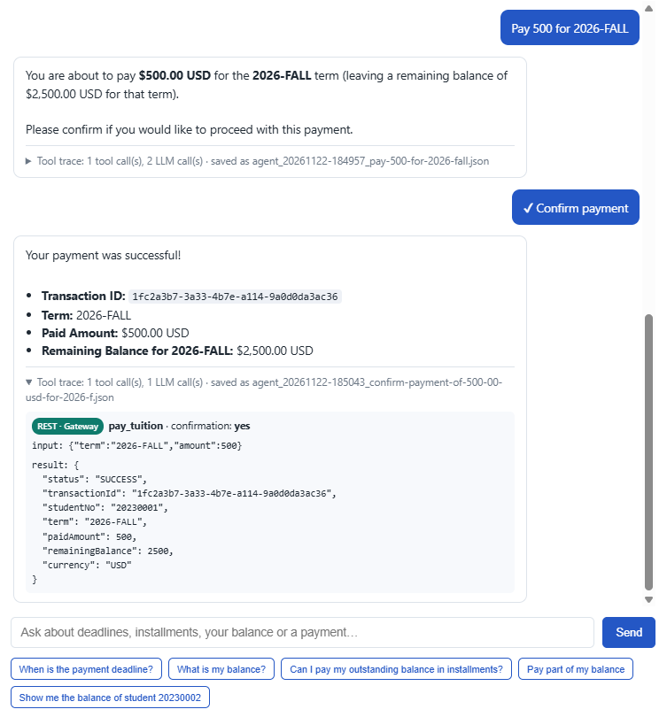

**Cloud (AWS)**

| | |
|---|---|
| 11. Swagger UI through the cloud gateway<br>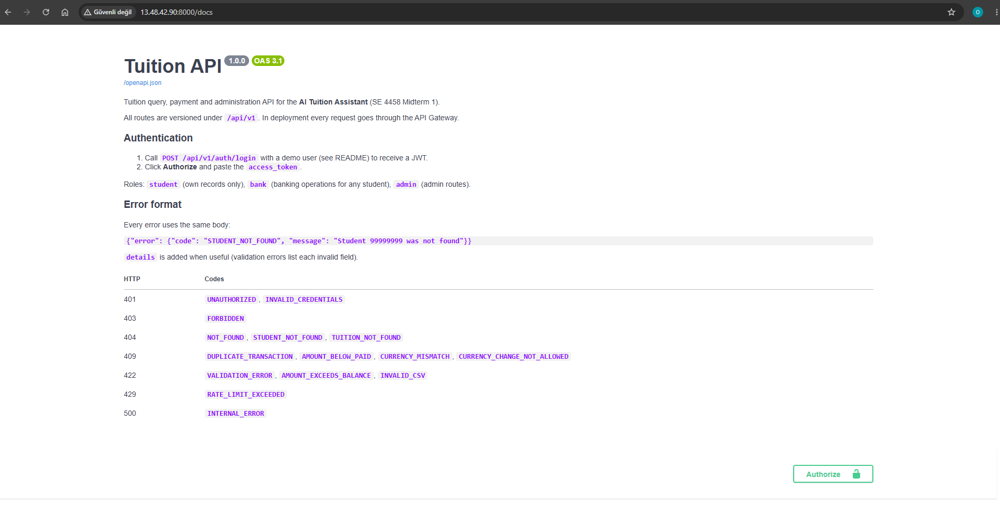 | 12. EC2 instance `tuition-vm` running in `eu-north-1`<br>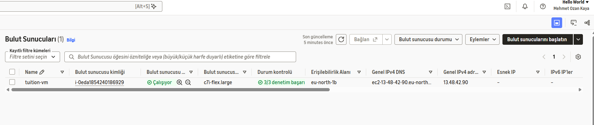 |

### Video

Demo video (about 5 minutes, Turkish narration): [Google Drive – SE 4458 Midterm 1 demo](https://drive.google.com/file/d/1bE7X2sjuSCphRv3zTAYNrAX4laLIRdst/view?usp=sharing)
