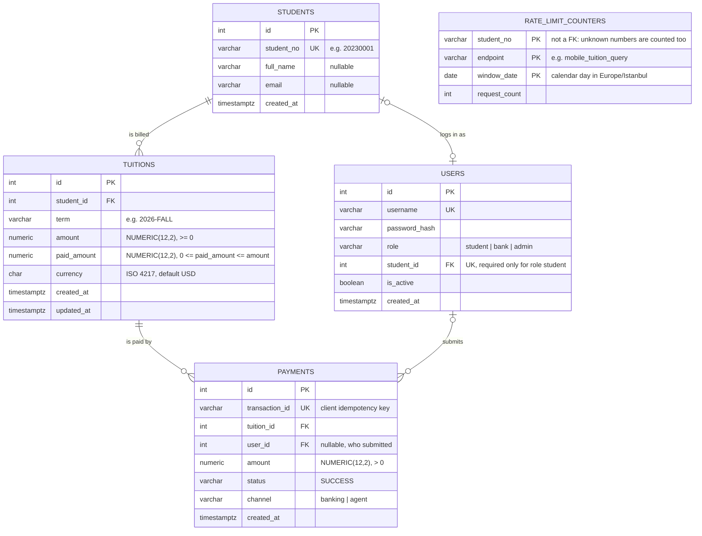

# Data Model (ER Diagram)

The Tuition REST API stores live account data in PostgreSQL. The policy document is **not** part of this
database; it is indexed separately by the MCP server.

## Tables

| Table | Purpose | Key constraints |
|---|---|---|
| `students` | Student identity | `student_no` unique |
| `users` | Login accounts for the demo roles | `username` unique; `role IN ('student','bank','admin')`; `student_id` unique and `NOT NULL` when `role = 'student'`, `NULL` otherwise |
| `tuitions` | Assessed tuition per student and term | `UNIQUE (student_id, term)`; `amount >= 0`; `0 <= paid_amount <= amount` |
| `payments` | Immutable payment ledger | `transaction_id` unique (duplicate submissions are rejected); `amount > 0` |
| `rate_limit_counters` | Daily counter for the mobile query limit | Composite PK `(student_no, endpoint, window_date)`; incremented atomically with `INSERT ... ON CONFLICT DO UPDATE` |

## Derived values

- **Term balance** = `tuitions.amount - tuitions.paid_amount`.
- **Overall tuition total / balance** = sums over all of a student's `tuitions` rows.
- `tuitions.paid_amount` is a running total kept in sync with `payments` inside the same database
  transaction. It lets the payment endpoint lock a single row (`SELECT ... FOR UPDATE`) and check the
  balance without race conditions. The `payments` table remains the audit trail.

## Design notes

- Terms are stored as strings in the format `YYYY-FALL`, `YYYY-SPRING` or `YYYY-SUMMER`; no separate terms
  table is needed for this scope.
- `rate_limit_counters.student_no` is intentionally not a foreign key, so requests for unknown student
  numbers are also limited.
